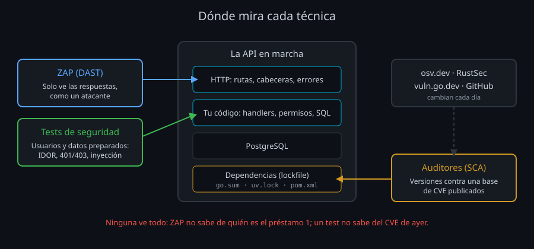

# 01 - OWASP Top 10 desde el tester

> Herramientas: los tests de Go que ya escribes, **OWASP ZAP** con Docker y el auditor de dependencias de cada lenguaje

Hasta ahora tus tests comprueban que el sistema hace lo que debe cuando lo usan bien: el socio pide un préstamo y el préstamo se abre. Un test de seguridad mira desde el otro lado: ¿qué pasa si alguien manda lo que nadie esperaba?, ¿si cambia un número de la URL?, ¿si no manda el token? Las herramientas son las mismas. Lo que cambia es quién está al otro lado de la petición.

---

## 🎯 Objetivos

- Situar cada categoría del OWASP Top 10 2025 y saber cuáles se pueden probar con un test.
- Escribir casos de abuso: tests que hacen de atacante y comprueban que el sistema se defiende.
- Distinguir las tres técnicas de la semana (tests en el código, escaneo de la aplicación en marcha y auditoría de dependencias) por lo que cada una ve.
- Saber qué no demuestra un test de seguridad.

---

## 1. El OWASP Top 10

OWASP (*Open Worldwide Application Security Project*) es una fundación sin ánimo de lucro que publica guías y herramientas de seguridad gratuitas. Su documento más conocido es el **Top 10**: las diez categorías de riesgo más importantes en aplicaciones web, ordenadas a partir de datos de miles de aplicaciones reales. La edición actual es la de 2025.

| Categoría | Qué falla | ¿Se prueba con un test? | Esta semana |
|---|---|---|---|
| **A01 Broken Access Control** | Un usuario hace o ve algo que no le corresponde: el préstamo de otro socio, borrar sin ser administrador | Sí: un test por usuario y recurso | Teoría 03, lab 02 |
| **A02 Security Misconfiguration** | La configuración deja una puerta abierta: cabeceras ausentes, errores con detalles internos | Sí: un test que lee las cabeceras; ZAP lo comprueba desde fuera | Teoría 04, lab 03 |
| **A03 Software Supply Chain Failures** | Una dependencia tiene una vulnerabilidad publicada, o no es lo que dice ser | No con tests: con un auditor de dependencias | Teoría 04, lab 04 |
| **A04 Cryptographic Failures** | Datos sensibles sin cifrar o con algoritmos débiles | Parcialmente (TLS, *hashes* de contraseñas) | Fuera de la semana |
| **A05 Injection** | Un dato del usuario acaba ejecutado como código: SQL, HTML, comandos | Sí: un test con cargas maliciosas | Teoría 02, lab 01 |
| **A06 Insecure Design** | El diseño no contempla un abuso: préstamos de 9 trillones de días | Sí, cuando se escribe el caso de abuso | Proyecto |
| **A07 Authentication Failures** | El sistema no comprueba bien quién eres | Sí: peticiones sin token o con un token falso | Teoría 03, lab 02 |
| **A08 Software or Data Integrity Failures** | Se confía en código o datos sin verificar su origen | Poco con tests: firmas, CI | Semana 45 |
| **A09 Security Logging and Alerting Failures** | Un ataque no deja rastro o nadie se entera | Parcialmente: un test puede leer el log | Lab 01 (el error va al log) |
| **A10 Mishandling of Exceptional Conditions** | Un error o un valor extremo deja el sistema en un estado inseguro: un 500 con el SQL, un desbordamiento | Sí: valores límite y errores provocados | Lab 01, proyecto |

Las categorías no son vulnerabilidades concretas sino familias. Cada una agrupa varias CWE (*Common Weakness Enumeration*), el catálogo de tipos de fallo de MITRE. La inyección SQL, por ejemplo, es la CWE-89. ZAP y los auditores citan la CWE o el CVE de cada hallazgo. Un **CVE** (*Common Vulnerabilities and Exposures*) es una vulnerabilidad concreta de un producto concreto, con un identificador público como CVE-2022-42889.

---

## 2. Casos de abuso

Un test funcional sigue el camino feliz y sus errores previstos: libro que no existe, 404. Un **caso de abuso** sigue el camino de alguien que quiere romper algo. Para encontrarlos, recorre cada entrada de la API y hazte cuatro preguntas:

| Pregunta | Ejemplo en la biblioteca | Test |
|---|---|---|
| ¿Y si el dato no es un dato? | `q=' OR '1'='1` en la búsqueda | La búsqueda devuelve 0 libros, no 6 |
| ¿Y si no digo quién soy? | `DELETE /api/books/6` sin cabecera `Authorization` | 401 |
| ¿Y si digo que soy otro, o pido lo de otro? | Luis pide `/api/loans/1`, el préstamo de ana | 404, igual que un préstamo que no existe |
| ¿Y si el valor es extremo? | `{"days": 9223372036854775807}` | 422 y la pieza sigue disponible |

El test de un caso de abuso tiene la misma forma que cualquier otro (preparar, actuar, comprobar), con una diferencia: casi siempre comprueba **dos cosas**. La respuesta (el código de estado) y que **nada cambió** (la pieza sigue disponible, el libro sigue en la tabla). Un 403 que llega después de haber borrado el libro no defiende nada.

Un test de seguridad que pasa a la primera no prueba nada hasta que lo ves fallar. En los labs, cada test se ejecuta antes contra la API vulnerable, y en el proyecto rompes el código a propósito para ver que el test lo detecta.

---

## 3. Tres técnicas, tres puntos de vista

| | Tests de seguridad | Escaneo dinámico (DAST) | Auditoría de dependencias (SCA) |
|---|---|---|---|
| Qué es | Tests de Go con `httptest`, como los de la [semana 34](../../week-34-http_bd_e_integracion_en_go/README.md) | Un programa que hace peticiones a la aplicación en marcha y analiza las respuestas | Un programa que compara las versiones de tus dependencias con una base de datos de vulnerabilidades |
| Herramienta | `go test` | OWASP ZAP | `pnpm audit`, `uv audit`, OSV-Scanner, `govulncheck`, `cargo audit` |
| Qué ve | Tu código, con los usuarios y datos que el test prepara | Solo las respuestas HTTP, como un atacante | Solo el lockfile (y, `govulncheck`, las llamadas) |
| Qué encuentra bien | Autorización, IDOR, inyección, validación de valores | Cabeceras, cookies, información que se filtra; con el modo activo, inyecciones | CVE conocidos en las versiones que usas |
| Qué no ve | Lo que no se te ocurrió probar | La lógica del negocio: no sabe que luis no debe ver el préstamo de ana | Tu propio código |
| Cuándo se ejecuta | En cada cambio, en segundos | Contra un entorno desplegado, en minutos | En cada cambio de dependencias y cada día (salen CVE nuevos) |

DAST significa *Dynamic Application Security Testing*: prueba la aplicación ejecutándose. Su contrario, SAST (*Static*), analiza el código sin ejecutarlo. Ya usaste SAST sin llamarlo así: `go vet`, staticcheck y clippy encuentran algunos fallos de seguridad. SCA significa *Software Composition Analysis*: analiza los componentes de terceros.

Ninguna sustituye a otra. ZAP no sabe quién es ana, así que nunca encontrará un IDOR. Un test no sabe que salió un CVE ayer en `lodash`. Y un auditor no lee tu `fmt.Sprintf` con SQL dentro.

---

## 4. Lo que un test de seguridad no demuestra

Un test demuestra que **un ataque concreto** no funciona. No demuestra que el sistema sea seguro. Si el test prueba tres cargas de inyección SQL, sabes que esas tres fallan, no que fallen todas. Por eso los tests de esta semana buscan la causa además del síntoma: la búsqueda de la biblioteca deja de ser vulnerable porque la consulta pasa a usar un parámetro (`$1`), no porque el test pruebe más cargas. El test se queda en la suite para avisar si alguien vuelve a concatenar SQL.

Tampoco sustituye a una **prueba de penetración** (*pentest*): un especialista que ataca el sistema con creatividad y herramientas propias. Los tests y los escaneos automáticos dejan para el pentest lo difícil; sin ellos, el pentest se gasta en encontrar cabeceras que faltan.

> **Solo contra lo tuyo.** Escanear o atacar un sistema sin permiso de su dueño es ilegal en casi todos los países, aunque sea "para probar". Esta semana todo se ejecuta contra APIs que arrancas en tu equipo (`localhost`). Antes de apuntar ZAP a un entorno compartido de tu trabajo, pide permiso por escrito.

---

## ✅ Resumen

- El OWASP Top 10 2025 agrupa los riesgos en diez familias. A01 (control de acceso), A02 (configuración), A05 (inyección), A06 (diseño), A07 (autenticación) y A10 (condiciones excepcionales) se prueban con tests; A03 (cadena de suministro) se audita.
- Un caso de abuso hace de atacante y comprueba la respuesta y que nada cambió. Un test de seguridad se ve fallar antes de darlo por bueno.
- Tests, DAST (ZAP) y SCA (auditores) ven cosas distintas y se complementan.
- Un test demuestra que un ataque concreto falla, no que el sistema sea seguro. Y solo se ataca lo propio.

<!-- nav -->
---

## 🔗 Navegación

| Anterior | Siguiente |
|---|---|
| ← [Semana 44 - Testing de Seguridad Básico (OWASP)](../README.md) | [Teoría — 02 - Inyección SQL y XSS](02-inyeccion-y-xss.md) → |

[↑ Semana 44](../README.md)
