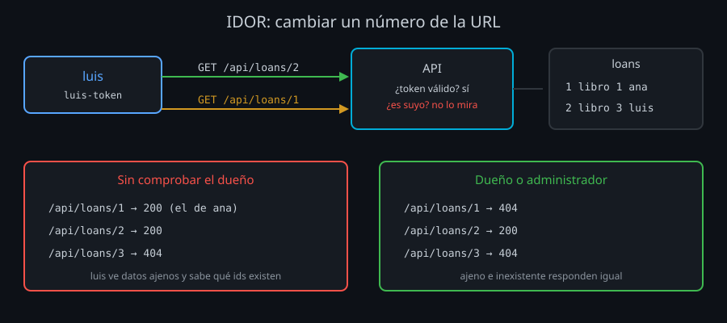

# 03 - Autenticación, autorización e IDOR

> Herramientas: `go test` con dos o más usuarios de prueba

**Autenticación** es saber quién hace la petición. **Autorización** es decidir si esa persona puede hacer lo que pide. Son dos comprobaciones distintas, y la mayoría de los fallos de A01 (*Broken Access Control*, el primero del Top 10) están en la segunda: la API sabe que eres luis, pero no comprueba que el préstamo que pides es tuyo.

---

## 🎯 Objetivos

- Elegir entre 401, 403 y 404 según lo que falla.
- Probar la autenticación: sin cabecera, con un token desconocido y con otro esquema.
- Probar la autorización con una matriz de usuarios por acción.
- Encontrar un IDOR con un test de dos usuarios y comprobar que la respuesta no permite enumerar recursos.
- Reconocer la asignación masiva y la suplantación en el cuerpo de la petición.

---

## 1. 401, 403 y 404

| Código | Significa | Cuándo |
|---|---|---|
| **401 Unauthorized** | No sé quién eres | Sin cabecera `Authorization`, token desconocido o caducado. La respuesta lleva `WWW-Authenticate` con el esquema que se espera (`Bearer`) |
| **403 Forbidden** | Sé quién eres y no puedes hacer esto | Un socio intenta borrar un libro, que es solo para administradores |
| **404 Not Found** | No existe, o no te digo que existe | El préstamo de otro socio, cuando saber que existe ya es información |

El nombre de 401 es engañoso: dice *Unauthorized* pero significa "no autenticado". Una API que devuelve 403 sin token, o 200 con un cuerpo vacío, confunde a sus clientes y a sus tests.

### El token Bearer

Las APIs de los labs y del proyecto usan un **token Bearer**: una cadena secreta que el cliente manda en cada petición.

```text
Authorization: Bearer ana-token
```

Quien tiene el token es el usuario (*bearer* es "portador"). En un sistema real el token lo da un inicio de sesión y caduca; en los labs es fijo para que los tests no dependan de él. Lo que se prueba es lo mismo: que la API lo pide y lo comprueba.

---

## 2. Probar la autenticación

Los casos que una API debe rechazar con 401:

```go
cases := map[string]string{
	"sin cabecera":      "",
	"token desconocido": "no-existe",
	"token de otra API": "ana-token-falso",
}
```

Y en el proyecto, dos más que fallan en APIs reales: el esquema `Basic` en lugar de `Bearer` y `Bearer` sin nada detrás. Cada caso comprueba el 401 y, en una acción que cambia datos, que no cambió nada.

En la biblioteca, estos tests pasan a la primera: `GET /api/loans/{id}` sí comprueba el token. Que pasen no los hace inútiles. Se quedan en la suite para avisar el día que alguien añada una ruta nueva y olvide la comprobación, que es justo lo que le pasó a `DELETE /api/books/{id}`.

---

## 3. Probar la autorización: la matriz

Con varios roles, la autorización es una tabla: cada fila es un usuario, cada columna una acción, y cada celda el código esperado.

| | `GET /api/loans/1` (de ana) | `DELETE /api/books/6` |
|---|---|---|
| Sin token | 401 | 401 |
| ana (socia, dueña del préstamo 1) | 200 | 403 |
| luis (socio) | 404 | 403 |
| admin | 200 | 204 |

Cada celda es un caso de un test de tabla. La tabla se escribe antes de mirar el código, a partir de lo que dice la especificación, y se prueba entera. Los fallos de autorización suelen estar en la celda que nadie probó: el administrador puede, el socio no puede... y el anónimo, que nadie pensó, sí puede.

---

## 4. IDOR

Un **IDOR** (*Insecure Direct Object Reference*) es una API que usa el identificador que llega en la petición para buscar un recurso y no comprueba que el recurso pertenece a quien lo pide.



En la biblioteca, ana tiene el préstamo 1 y luis el 2. Luis abre el suyo en `/api/loans/2`, cambia el 2 por un 1 y ve el de ana. No hace falta ninguna herramienta: basta con editar la URL. Por eso A01 es el primero del Top 10.

El test necesita dos usuarios y un recurso de uno de ellos:

```go
res, body := send(t, srv, http.MethodGet, "/api/loans/1", "luis-token")
// quiero 404
_, missing := send(t, srv, http.MethodGet, "/api/loans/999", "luis-token")
// y la misma respuesta que un préstamo que no existe
```

### 404 y no 403

Si la API respondiera 403 al préstamo de otro y 404 al que no existe, luis podría recorrer los ids y saber cuáles existen (**enumeración**). En la API vulnerable del lab 02:

```text
luis -> /api/loans/1: 200
luis -> /api/loans/2: 200
luis -> /api/loans/3: 404
```

Después de la corrección, el préstamo de ana y uno que no existe son iguales para luis:

```text
luis -> /api/loans/1: 404
luis -> /api/loans/2: 200
luis -> /api/loans/3: 404
```

Por eso el test compara los cuerpos de las dos respuestas, no solo los códigos. Usar ids aleatorios (UUID) en lugar de 1, 2, 3 hace más difícil adivinarlos, pero no es una corrección: un id se filtra en un log, un correo o una captura de pantalla. La comprobación de dueño tiene que estar.

### IDOR al escribir

El IDOR también ocurre al crear. La API del museo recibe el préstamo con la institución en el cuerpo:

```json
{"institutionId": "MNBA", "days": 30}
```

Si la institución sale del cuerpo y no del token, MALI puede pedir préstamos a nombre de MNBA. La corrección es que la institución salga del token; el campo del cuerpo, si se mantiene por compatibilidad, solo se acepta si coincide (403 si no). El test: token de MALI, cuerpo con MNBA, 403 y la pieza sigue disponible.

### Asignación masiva

La **asignación masiva** (*mass assignment*) es el caso general: el cliente manda campos que no debería controlar (`"status": "AVAILABLE"`, `"declaredValue": 1`) y la API los copia al objeto. En Go, decodificar en un `struct` que solo tiene los campos permitidos (`Days`, `InstitutionID`) ya protege: los demás campos del JSON se ignoran. Un test que manda esos campos y comprueba que la pieza no cambió protege esa decisión de un refactor que decodifique directamente en `Piece`.

---

## ✅ Resumen

- 401: no sé quién eres (con `WWW-Authenticate`). 403: sé quién eres y no puedes. 404: no existe, o no te digo que existe.
- La autenticación se prueba sin cabecera, con un token desconocido y con otro esquema. Un test que pasa a la primera se queda como guardia.
- La autorización es una matriz de usuarios por acciones; cada celda es un caso de un test de tabla.
- Un IDOR se prueba con dos usuarios. La respuesta al recurso ajeno es idéntica a la de uno que no existe, para que no se pueda enumerar.
- La institución, el dueño o el rol salen del token, nunca del cuerpo. Los campos que el cliente no controla no se decodifican.

<!-- nav -->
---

## 🔗 Navegación

| Anterior | Siguiente |
|---|---|
| ← [Teoría — 02 - Inyección SQL y XSS](02-inyeccion-y-xss.md) | [Teoría — 04 - Cabeceras, ZAP y auditoría de dependencias](04-cabeceras-zap-y-dependencias.md) → |

[↑ Semana 44](../README.md)
