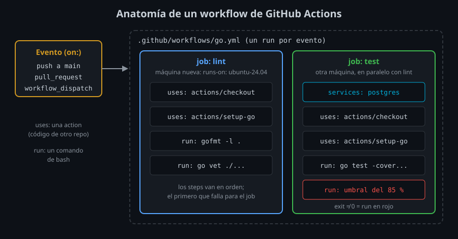
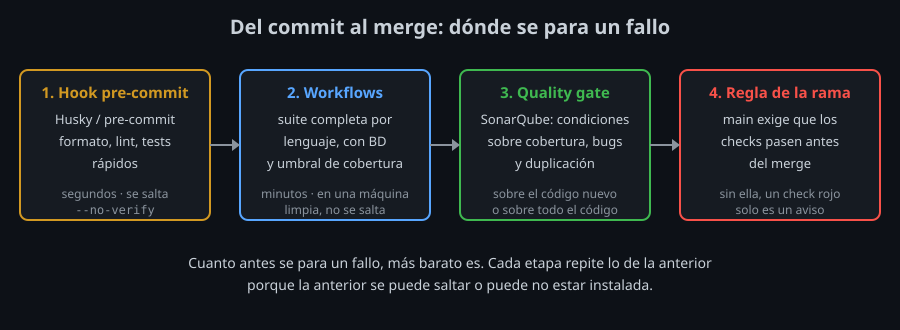

# 01 - CI/CD y anatomía de un workflow

> Herramientas: **GitHub Actions** y la CLI `gh`

Tus suites pasan en tu equipo. Eso dice poco de si pasan en el de otra persona, o en el tuyo dentro de un mes. La **integración continua** ejecuta las suites en una máquina limpia cada vez que alguien sube un cambio, y avisa en el *pull request* antes de mezclarlo. Esta semana conviertes cada `verify.sh` del curso en un workflow de GitHub Actions.

---

## 🎯 Objetivos

- Distinguir integración continua, entrega continua y despliegue continuo.
- Leer y escribir un workflow: eventos, jobs, steps, runners y permisos.
- Seguir un run desde la terminal con `gh` y leer el log de un step que falla.
- Saber qué hace que un check rojo bloquee un merge.

---

## 1. CI y CD

| Término | Qué hace | En este curso |
|---|---|---|
| **Integración continua (CI)** | Cada cambio que se sube se compila y se prueba automáticamente, en una máquina que no es la tuya | Esta semana: un workflow por lenguaje |
| **Entrega continua (CD, *delivery*)** | Además, cada cambio que pasa queda empaquetado y listo para desplegar con un botón | Fuera del curso |
| **Despliegue continuo (CD, *deployment*)** | Cada cambio que pasa se despliega solo, sin botón | Fuera del curso |

Para un tester, la CI es donde las suites que escribiste trabajan sin que nadie las ejecute. Un test que nadie ejecuta no protege nada; en la CI se ejecuta en cada *push* y en cada *pull request*.

La máquina limpia es la mitad del valor. En tu equipo hay cosas que la suite usa sin decirlo: un PostgreSQL arrancado, una variable de entorno, un paquete instalado a mano, una caché. En la CI no hay nada de eso, así que un workflow verde también prueba que el repositorio dice todo lo que necesita.

---

## 2. GitHub Actions

GitHub Actions ejecuta **workflows**: archivos YAML en `.github/workflows/` de la raíz del repositorio. Solo esa carpeta cuenta; un workflow en `js/.github/workflows/` no se ejecuta nunca.



El workflow del lab 01, entero:

```yaml
name: js

on:
  push:
    branches: [main]
  pull_request:
  workflow_dispatch:

permissions:
  contents: read

jobs:
  test:
    runs-on: ubuntu-24.04
    defaults:
      run:
        working-directory: js
    steps:
      - uses: actions/checkout@v7
      - uses: pnpm/action-setup@v6
        with:
          package_json_file: js/package.json
      - uses: actions/setup-node@v7
        with:
          node-version: 22
          cache: pnpm
          cache-dependency-path: js/pnpm-lock.yaml
      - run: pnpm install --frozen-lockfile
      - run: pnpm test
```

| Clave | Qué es | Para qué |
|---|---|---|
| `name` | El nombre del workflow | Aparece en la pestaña *Actions* y en los checks del PR |
| `on` | Los **eventos** que lo disparan | `push` a `main`, cada `pull_request` y `workflow_dispatch` (un botón para lanzarlo a mano) |
| `permissions` | Lo que puede hacer el token del workflow | `contents: read`: leer el código y nada más. Si una action tuviera un fallo, no podría escribir en el repositorio |
| `jobs` | Los trabajos del workflow | Cada job corre en una **máquina nueva**; sin `needs`, todos a la vez |
| `runs-on` | El **runner**: la máquina del job | `ubuntu-24.04` fija la versión; `ubuntu-latest` cambia sola cuando GitHub publica una nueva |
| `defaults.run.working-directory` | Carpeta de los `run` | El repositorio del curso tiene un proyecto por carpeta |
| `steps` | Los pasos del job, en orden | El primero que termina con un código distinto de 0 para el job y lo pone en rojo |
| `uses` | Una **action**: código de otro repositorio que hace una tarea | `actions/checkout` descarga tu código; `setup-node` instala Node |
| `with` | Las entradas de una action | Cada action documenta las suyas |
| `run` | Un comando de bash | Lo mismo que escribirías en la terminal |

Dos detalles que se olvidan:

- **El job empieza vacío.** Sin `actions/checkout`, la máquina no tiene tu código. Cada job lo descarga de nuevo, porque cada job es una máquina distinta.
- **`--frozen-lockfile`.** En la CI, `pnpm install` no debe cambiar el lockfile: si `package.json` y `pnpm-lock.yaml` no coinciden, falla. Es lo mismo que `uv sync --locked` en Python. En tu equipo actualizas el lockfile; la CI instala exactamente lo que dice.

### Versiones de las actions

`actions/checkout@v7` es una etiqueta del repositorio de la action. La etiqueta mayor (`v7`) avanza con cada versión compatible. No todas las actions la publican: `astral-sh/setup-uv` solo publica versiones completas, y `@v10` falla antes de empezar el job ([lab 02](../2-practicas/lab-02-matrix-cache-y-artifacts/README.md)):

```text
X Unable to resolve action `astral-sh/setup-uv@v10`, unable to find version `v10`
```

Una etiqueta se puede mover a otro commit. Los equipos que no quieren que el código de una action cambie sin que se enteren fijan el *hash* del commit (`uses: actions/checkout@<40 caracteres>`) y lo actualizan con Dependabot. Es el A03 de la [semana 44](../../week-44-testing_de_seguridad_basico_owasp/1-teoria/01-owasp-top-10-para-testers.md): una action es una dependencia más.

---

## 3. Un run desde la terminal

Cada evento crea un **run** del workflow. La CLI `gh` lo sigue sin abrir el navegador:

```bash
gh run list -w js
# STATUS  TITLE                    WORKFLOW  BRANCH          EVENT         ID           ELAPSED  AGE
# X       Remove the late fee cap  js        remove-fee-cap  pull_request  44425501542  38s      about 27 minutes ago
# ✓       Add JS workflow          js        main            push          44425293075  18s      about 29 minutes ago

gh run view 44425293075
# ✓ main js · 44425293075
# Triggered via push less than a minute ago
#
# JOBS
# ✓ test in 15s (ID 135228455858)
```

| Comando | Para qué |
|---|---|
| `gh run list` | Los últimos runs: estado, resultado, workflow, rama y evento |
| `gh run watch <id> --exit-status` | Espera a que termine; con `--exit-status`, sale con 1 si el run falla |
| `gh run view <id>` | Los jobs y sus steps |
| `gh run view <id> --log-failed` | Solo el log de los steps que fallaron |
| `gh run download <id>` | Descarga los artifacts ([teoría 03](03-matrix-artifacts-paralelismo-y-umbrales.md)) |
| `gh pr checks` | Los checks de la rama del PR actual |

El log de un step que falla es el mismo que verías en tu terminal. En el lab 01, sin el tope de la multa:

```text
    ✕ 365 days late costs 10000 (1 ms)
  ● lateFee › 365 days late costs 10000
    Expected: 10000
    Received: 182500
Tests:       1 failed, 6 passed, 7 total
[ELIFECYCLE] Test failed. See above for more details.
##[error]Process completed with exit code 1.
```

`##[error]` es como GitHub marca el error en el log. El step falló porque `pnpm test` terminó con código 1; el workflow no entiende de tests, solo de códigos de salida. Por eso los umbrales de cobertura de esta semana son comandos que terminan con 1.

---

## 4. Del check rojo al merge bloqueado

En un *pull request*, cada job de cada workflow es un **check**:

```bash
gh pr checks
# test  fail  34s  https://github.com/ergrato-dev/ci-lab/actions/runs/44425501542/job/135229153580
```

Un check rojo no impide nada por sí solo: el botón de *merge* sigue activo. Para que lo impida, la rama `main` necesita una regla (*Settings → Rules → Rulesets*, o *Branch protection* en repositorios antiguos) con **Require status checks to pass** y la lista de checks obligatorios. Con la regla, el check rojo bloquea el merge y GitHub muestra el motivo.



Un check que nunca se ejecuta, por un filtro de `paths` ([teoría 03](03-matrix-artifacts-paralelismo-y-umbrales.md)), se queda "esperando" para siempre si está en la lista de obligatorios. Por eso, con filtros de rutas, la lista de checks obligatorios se elige con cuidado.

---

## ✅ Resumen

- CI: cada cambio se prueba en una máquina limpia. CD: además se empaqueta (*delivery*) o se despliega (*deployment*).
- Un workflow vive en `.github/workflows/` de la raíz. Eventos (`on`), jobs en máquinas separadas y en paralelo, steps en orden; el primero que falla pone el job en rojo.
- `permissions: contents: read` limita el token. `ubuntu-24.04` fija el runner. Las etiquetas de las actions son dependencias: algunas no tienen etiqueta mayor.
- `gh run list`, `watch`, `view --log-failed` y `gh pr checks` siguen todo desde la terminal.
- Un check rojo solo bloquea el merge si una regla de la rama lo exige.

<!-- nav -->
---

## 🔗 Navegación

| Anterior | Siguiente |
|---|---|
| ← [Semana 45 - CI/CD y Testing Automatizado](../README.md) | [Teoría — 02 - Preparar cada lenguaje, cachés y servicios](02-preparar-cada-lenguaje-caches-y-servicios.md) → |

[↑ Semana 45](../README.md)
