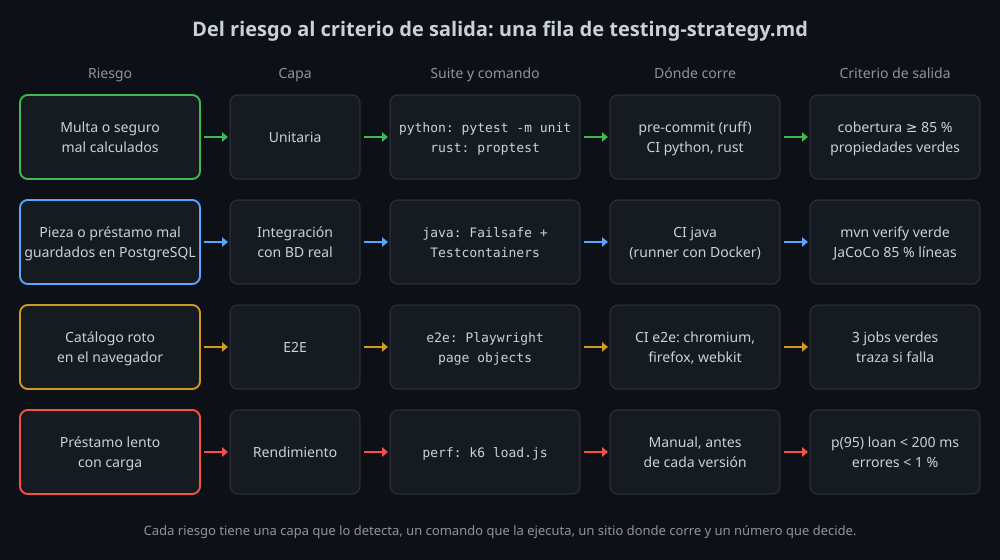

# 01 - La estrategia de testing del repositorio

> Todos los lenguajes del curso: **JavaScript, Python, Java, Go y Rust**, más E2E, rendimiento, seguridad y CI

Esta semana no hay conceptos de testing nuevos. Tu repositorio `qa-<nombre>-<apellido>` ya tiene una suite por lenguaje, E2E, rendimiento, seguridad y un workflow por suite. Lo que falta es lo que explica el conjunto: **`testing-strategy.md`**, que dice qué se prueba, dónde y con qué criterio, y por qué; y un **`README.md`** en la raíz que permite a otra persona ejecutarlo todo sin preguntarte.

---

## 🎯 Objetivos

- Distinguir la estrategia de testing de un repositorio del plan de pruebas de una entrega.
- Hacer el inventario de todas las suites con números de ejecuciones reales.
- Juntar los riesgos de los reportes de cada suite en una sola lista y llevar cada riesgo a una capa, un comando, un sitio donde corre y un criterio.
- Escribir decisiones con contexto, alternativas y consecuencias.
- Escribir el README de la raíz con el estado del repositorio.

---

## 1. Del plan de pruebas a la estrategia

En la [semana 6](../../week-06-plan_de_pruebas_y_suite_base_multilenguaje/1-teoria/01-plan-de-pruebas-y-trazabilidad.md) escribiste `test-plan.md`: qué casos prueban qué requisitos de una entrega. La estrategia cubre otra cosa:

| | `test-plan.md` (semana 6) | `testing-strategy.md` (esta semana) |
|---|---|---|
| Pregunta | ¿Qué casos prueban esta entrega? | ¿Cómo se prueba este sistema, y por qué así? |
| Unidad | Requisitos y casos de prueba | Riesgos, capas, suites y herramientas |
| Dura | Lo que dura la entrega | Lo que dura el repositorio: se actualiza con cada decisión |
| Lo lee | Quien prueba la entrega | Quien llega al proyecto, quien lo revisa, tú dentro de seis meses |

Una estrategia no repite los reportes de cada suite (`testing-report-python.md`, `performance-report.md`...). Los enlaza y responde lo que ninguno responde solo: qué riesgo del sistema cubre cada suite, cuáles no cubre ninguna y qué decide si una versión sale.

---

## 2. Inventario: los números salen de ejecutar

Antes de escribir una línea de estrategia, ejecuta cada suite con el mismo comando que usa su workflow y apunta lo que sale. Estos son los del museo, ejecutados uno detrás de otro en un mismo equipo:

| Suite | Capas | Tests | Cobertura | Tiempo local |
|---|---|---|---|---|
| `python/` | Unitaria, API, repositorio (Testcontainers), BDD | 20 de pytest y 3 escenarios de Behave | 100 % con ramas | 9 s |
| `java/` | Unitaria (Surefire), integración y Cucumber (Failsafe) | 67 + 43 | 98.7 % de líneas | 36 s |
| `go/` | Unitaria e integración (testcontainers-go), fuzz, benchmarks | 36 tests y 80 subtests | 92.3 % de sentencias | 8 s |
| `rust/` | Unitaria, integración, PostgreSQL con `#[sqlx::test]`, doctests, benchmarks | 72 de nextest y 3 doctests | 97.96 % de líneas | 91 s |
| `e2e/` | E2E con page objects | 13 por navegador | No aplica | 41.5 s (chromium) |
| `perf/` | Carga (k6) y estrés (Locust) | 2 escenarios de k6 | No aplica | 90 s la prueba de carga |
| `security/` | Tests de seguridad (Go) y auditoría de dependencias | 9 tests y 6 auditorías | No aplica | Lo que tardan las auditorías |

Tres cosas que el inventario enseña:

- **Los totales no se comparan entre lenguajes.** Un test de Go con 10 subtests, un escenario de Behave y una propiedad que genera 64 casos cuentan como «un test». Compara capas, no totales.
- **El tiempo dice dónde puede correr cada suite.** Lo que tarda segundos cabe en un hook o en cada *push*. Los 90 s de k6 con un servidor arrancado, no.
- **El inventario encuentra huecos.** En el [lab 01](../2-practicas/lab-01-inventario-del-repositorio/README.md), `ci-lab` resulta tener tres umbrales distintos: ninguno en JavaScript, 80 % en Python y 85 % en Go, este último escrito en el workflow y no en el proyecto.

---

## 3. Riesgos: de cada reporte a una lista del sistema

Cada `testing-report-*.md` termina con sus riesgos. Leídos juntos, se repiten. En el museo, tres reportes dicen lo mismo con otras palabras:

- Go: «Sin transacción entre `Save` y `Open`».
- Java: «`lend` no es transaccional: guarda la pieza como `ON_LOAN` y después abre el préstamo».
- Rust: «El préstamo no es una transacción».

Es **un** riesgo del sistema (el préstamo a medias), presente en tres implementaciones. En la estrategia aparece una vez, con las tres suites que lo comparten y lo que haría falta para probarlo. Igual con «la API y PostgreSQL nunca se prueban juntos», que está en los reportes de Go y Rust.

Para cada riesgo, la estrategia contesta cuatro preguntas: qué capa lo detecta, qué comando ejecuta esa capa, dónde corre ese comando y qué número decide si pasa.



Un riesgo sin fila completa es un **riesgo abierto**, y también va en la estrategia. «La auditoría de dependencias no está en la CI» o «el E2E prueba una aplicación Node propia, no ninguna de las cuatro APIs» son tan útiles para quien lee como una suite en verde.

---

## 4. Qué se ejecuta y dónde

Cada comprobación vive en el sitio más barato donde puede vivir:

| Dónde | Cuándo | Qué corre en el museo | Por qué ahí |
|---|---|---|---|
| Hook de pre-commit | Cada `git commit` | Formato y lint: `ruff`, `gofmt`, `go vet`, `cargo fmt`, `clippy` | Segundos; el error llega antes de subirlo |
| Local | Cuando trabajas en una suite | `go/verify.sh`, `rust/verify.sh`, `mvn verify`, pytest + Behave, Playwright | El mismo comando que la CI |
| CI, en cada *push* y PR | Si el cambio toca la carpeta (`paths`) | Las cinco suites, cada una en su workflow | Máquina limpia; el check bloquea el merge |
| A mano, antes de cada versión | Antes de etiquetar una versión | k6 y Locust, ZAP, `security/audit.sh` | Necesitan un servidor arrancado, minutos y un entorno estable |

La última fila es una decisión, no un olvido: está escrita, y su riesgo (una dependencia vulnerable puede entrar entre dos versiones) también.

---

## 5. Criterios de salida

Un criterio de salida es una condición que se comprueba con un comando y que decide si una versión sale. Lo vago («cobertura suficiente», «rendimiento aceptable») no es un criterio.

| Criterio | Dónde vive | Quién lo comprueba |
|---|---|---|
| Cobertura ≥ 85 % en `python/`, `java/`, `go/` y `rust/` | `pyproject.toml`, `pom.xml`, `verify.sh` | Cada suite, en local y en la CI |
| Los cinco workflows en verde en `main` | `.github/workflows/` | GitHub, en cada PR |
| E2E verde en chromium, firefox y webkit | `e2e/playwright.config.ts` y la matriz de `e2e.yml` | La CI |
| p95 de la ficha < 100 ms, del préstamo < 200 ms, errores < 1 % | `thresholds` de `perf/k6/load.js` | k6 termina con código distinto de 0 si no se cumple |
| Ninguna vulnerabilidad conocida en las dependencias | `security/audit.sh` | El script termina con 1 si alguna auditoría encuentra algo |

Cada fila tiene un número y un comando que lo comprueba, y el número vive en el proyecto, no en el documento: si alguien cambia el umbral, el documento queda desfasado y la revisión del PR lo ve.

---

## 6. Decisiones

Una estrategia es sobre todo una lista de decisiones. Cada una con cuatro partes:

```markdown
### D2 - PostgreSQL con Testcontainers en Java, Go y Python

- **Contexto:** los tests de repositorio necesitan una base de datos real; el runner de GitHub tiene Docker.
- **Decisión:** cada suite arranca su PostgreSQL con Testcontainers. Rust usa `docker compose up --wait` y `#[sqlx::test]`.
- **Alternativas:** un contenedor de servicio en el workflow (lab 03 de la semana 45); una base de datos compartida.
- **Consecuencias:** el mismo comando en local y en la CI, sin pasos en el workflow. Cada ejecución descarga o reutiliza la imagen y tarda unos segundos en arrancarla.
```

Las alternativas son la parte que más se olvida y la que más vale: dicen que hubo una elección. Las consecuencias incluyen lo malo. Una decisión sin coste no es una decisión.

---

## 7. El README de la raíz

`testing-strategy.md` explica el porqué. El `README.md` de la raíz es para ejecutar: alguien clona el repositorio y en cinco minutos sabe qué hay y cómo correrlo.

| Sección | Qué lleva |
|---|---|
| Título y dominio | Qué sistema es, en dos frases |
| Estado | Un *badge* por workflow y la cobertura de cada suite |
| Estructura | Una línea por carpeta |
| Requisitos | Herramientas y versiones, Docker |
| Cómo ejecutar las suites | El comando exacto de cada una, desde la raíz |
| Documentación | Enlaces a `testing-strategy.md` y a cada reporte |

Un *badge* es una imagen que GitHub genera con el estado del último run de un workflow en la rama principal:

```markdown

```

Si el workflow falla en `main`, la imagen pasa a *failing* sin tocar el README.

---

## ✅ Resumen

- La estrategia explica cómo se prueba el sistema y por qué. Enlaza los reportes, no los copia.
- Los números del inventario salen de ejecutar cada suite. Compara capas, no totales.
- Los riesgos de los reportes se juntan: el mismo riesgo en tres lenguajes es un riesgo. Cada uno va a una capa, un comando, un sitio y un criterio, o queda escrito como abierto.
- Cada comprobación corre en el sitio más barato posible: hook, local, CI o antes de cada versión.
- Un criterio de salida tiene un número y un comando. Una decisión tiene contexto, alternativas y consecuencias.
- El README de la raíz es para ejecutar: estado, estructura, requisitos, comandos y enlaces.

<!-- nav -->
---

## 🔗 Navegación

| Anterior | Siguiente |
|---|---|
| ← [Semana 46 - Proyecto Final: Bootcamp Testing Zero to Hero](../README.md) | [Índice de labs](../2-practicas/README.md) → |

[↑ Semana 46](../README.md)
